# pchic_gat: a trimodal promoter-centred graph attention network

This model predicts gene regulation from three sources of information about each promoter:

- **Sequence (Tower A).** The DNA in a 1,000,000 bp window around the TSS (hg19), read by a HyenaDNA-style long-convolution encoder.
- **Structure (Tower B).** The promoter's tissue-specific PCHi-C contact subgraph, read by a GATv2 graph attention network.
- **Epigenome (Tower C).** Promoter histone marks (H3K4me1, H3K4me3, H3K27ac, H3K27me3, H3K36me3, H3K9me3) and CTCF.

A gated fusion layer combines the three embeddings. Four supervised heads sit on top:

| head | task | type |
|---|---|---|
| H1 | is this promoter–fragment contact real? | binary link prediction |
| H2a / H2b | expression level, as `log2(TPM+1)`, and expressed or not (`TPM > 1`) | regression / binary |
| H3 | is the gene tissue-restricted? (Yanai's tau > 0.85) | binary |
| H4 | which of the 46 tissues does this graph come from? | multiclass |

The full run covers 46 tissues, 20,166 genes and 363,617 promoter subgraphs. It is evaluated with 5-fold cross-validation grouped by gene, so no gene's promoter is seen in both training and test. Chromosome-block CV and leave-one-tissue-out CV are reported alongside.

> The previous version of this repository (16 kb window, the single- and two-modality notebooks, and their results) is preserved unchanged on the [`main_old`](../../tree/main_old) branch.

---

## Contents

1. [Installation](#1-installation)
2. [Data](#2-data)
3. [Running the pipeline](#3-running-the-pipeline)
4. [Results](#4-results)
5. [Figures](#5-figures)
6. [Repository layout](#6-repository-layout)
7. [Method notes and caveats](#7-method-notes-and-caveats)
8. [Citation and licence](#8-citation-and-licence)

---

## 1. Installation

**Requirements**

- Linux x86-64.
- An NVIDIA GPU with CUDA 12.x drivers. The full run used one A100; H200 nodes were used for interactive work. The sequence bank (`n_genes × 1 Mb`, stored as uint8) is about 20 GB and is kept on the GPU when it fits.
- About 200 GB RAM for the full run, mostly for graph construction.
- Disk: about 1 GB for `reference/` and about 250 GB for the ENCODE histone bigWigs in `histone/` (the full set used here). `cache/` (graphs and the sequence bank) needs about 50 GB, and a full v3 run writes about 25 GB of feature tensors and checkpoints.

### 1.1 Get the code

```bash
git clone https://github.com/Kaustav-93/pchic_gat.git
cd pchic_gat
```

### 1.2 Install conda (Miniforge)

Skip this step if `conda` or `mamba` is already on your `PATH`.

```bash
curl -L -O https://github.com/conda-forge/miniforge/releases/latest/download/Miniforge3-Linux-x86_64.sh
bash Miniforge3-Linux-x86_64.sh -b -p "$HOME/miniforge3"
source "$HOME/miniforge3/etc/profile.d/conda.sh"
conda init bash          # optional: activates conda in every new shell
```

### 1.3 Create the `pchic` environment

`environment.yml` pins Python 3.10, the bioinformatics command-line tools from bioconda (bedtools, samtools, UCSC liftOver/bigWig tools), and PyTorch 2.5.1 + CUDA 12.1 with PyTorch Geometric. The PyTorch and PyG wheel indexes are listed inside the file, so one command installs everything:

```bash
conda env create -f environment.yml      # or: mamba env create -f environment.yml
conda activate pchic
```

The pipeline refuses to run in any other environment. Its preflight cell checks that `CONDA_DEFAULT_ENV` is `pchic`.

### 1.4 Register the Jupyter kernel (only needed for notebooks)

```bash
python -m ipykernel install --user --name pchic --display-name "Python (pchic)"
```

### 1.5 Check the install

```bash
python - <<'PY'
import torch, torch_geometric, pyBigWig, py2bit, sklearn, pandas
print("torch", torch.__version__, "| CUDA available:", torch.cuda.is_available())
print("torch_geometric", torch_geometric.__version__)
if torch.cuda.is_available():
    print("GPU:", torch.cuda.get_device_name(0))
PY
```

You should see `torch 2.5.1+cu121`, `CUDA available: True` and `torch_geometric 2.8.0.post1`.

**CPU-only or a different CUDA version.** Edit the three `+cu121` / `pt25cu121` suffixes and the two index URLs in `environment.yml` to match your setup (for example `cpu` and `https://data.pyg.org/whl/torch-2.5.1+cpu.html`). The full run is not practical on CPU.

---

## 2. Data

The pipeline expects four folders at the repository root. Their location is resolved from the `PANGENOMIC_ROOT` environment variable, or else by walking up from the working directory.

| folder | contents | how to get it |
|---|---|---|
| `reference/` | `hg19.2bit`, `hg19.chrom.sizes`, `refGene_hg19.txt`, liftOver chains (both directions) | `bash download_data.sh` |
| `histone/` | `{sample}.{mark}.bw` bigWigs, plus `DOWNLOAD_manifest.csv` | `bash download_data.sh` (calls `codes/fetch_histone_encode.py`) |
| `interection_data/` | 46 `NNNN_<Tissue>_merged_loop.txt` PCHi-C loop files (hg19) | **not distributed here.** Place the files in this folder (format below) |
| `rna_seq/` | `rnaseq.rsem_genes_tpm.txt` (plus FPKM and expected-count matrices) | **not distributed here.** Place the files in this folder (format below) |

### 2.1 Download the public references and histone tracks

```bash
conda activate pchic
bash download_data.sh --skip-hic
```

`--skip-hic` is correct for this pipeline: it builds graphs from PCHi-C loop calls only and never opens `.hic` matrices. Other useful flags:

- `--skip-genome` if `reference/` is already filled.
- `--skip-histone` to keep existing bigWigs.
- `--liftover-tracks` to write genuine hg19 bigWigs instead of lifting query coordinates at read time. This is slow and needs tens of GB of scratch per track.

Read `histone/DOWNLOAD_manifest.csv` before trusting a histone feature. Rows whose `match_quality` is `proxy` come from a related but different biosample. In the full run, 305 histone tracks were present, covering 93.5% of tissue × mark pairs. Missing marks are masked, never zero-filled silently.

**Optional, for Part XIII only** (enrichment of PCHi-C partners in regulatory elements): put ENCODE SCREEN's `GRCh37-ccREs.bed` in `reference/`. If it is absent, that Part is skipped.

### 2.2 Input formats for the data you supply

**`interection_data/NNNN_<Tissue>_merged_loop.txt`**: tab-separated, one PCHi-C interaction per row, hg19:

```
bait_frag                 other_frag                N_reads  score  bait_gene  bait_gene_strand  oe_gene  oe_gene_strand  ...
chr1,248601766,248607843  chr1,248810816,248816904  180      inf    OR2T7      +                 OR2T27   -               ...
```

`score` is the CHiCAGO score. `inf` is capped at the largest finite score while loading. Interactions with `score < 5` are dropped (`min_chicago`).

**`rna_seq/rnaseq.rsem_genes_tpm.txt`**: tab-separated RSEM TPM matrix. The columns are `gene_id`, `gene_name`, then one column per sample named `{id}_{GSE}_{Tissue}_{replicate}` (for example `0003_GSE86189_Spleen_0`). Replicates are averaged in linear TPM space per sample id. The `{id}` prefix must match the prefix of the loop files.

---

## 3. Running the pipeline

The current pipeline is **`notebooks/pangenomic_gat_pipeline_trimodal_1mb_SERVER_v3.py`**. It is a `# %%`-cell Python script, so you can run it as a batch job or convert it to a notebook. Every stage checkpoints after each epoch, so **re-running the script is resuming it**.

### 3.1 Interactively, as a notebook

```bash
conda activate pchic
python notebooks/py_to_ipynb.py notebooks/pangenomic_gat_pipeline_trimodal_1mb_SERVER_v3.py
jupyter lab notebooks/pangenomic_gat_pipeline_trimodal_1mb_SERVER_v3.ipynb
# Kernel -> Change Kernel -> "Python (pchic)"
```

### 3.2 As a single batch job

```bash
conda activate pchic
export PANGENOMIC_ROOT="$PWD" MPLBACKEND=Agg PYTHONUNBUFFERED=1
mkdir -p logs && cd notebooks
python -u pangenomic_gat_pipeline_trimodal_1mb_SERVER_v3.py 2>&1 | tee ../logs/v3_run.log
```

### 3.3 On a SLURM cluster (what produced the published results)

`run_trimodal_v3_chain.sbatch` is a self-resubmitting job. On a time-limit warning (`USR1`) or a crash it resubmits itself and resumes from the last checkpoint, up to 3 consecutive crashes. Stage A trains 15 encoders: 5 gene-CV folds, 5 chromosome-CV folds and 5 leave-one-tissue-out tissues. Any number of worker jobs can share those splits through lock files.

Before submitting, **edit the paths at the top of the script**: `PROJ`, the `source .../conda.sh` line, the `--output` log path, and the `--account` / `--partition` / `--gres` lines for your cluster. Then:

```bash
ROLE=main sbatch run_trimodal_v3_chain.sbatch
for i in $(seq 1 14); do ROLE=worker sbatch run_trimodal_v3_chain.sbatch; done   # optional, parallel Stage A

touch STOP_TRIMODAL_V3_CHAIN   # to stop the chain from resubmitting (then scancel the jobs)
```

`jupyter_h200.sh` starts JupyterLab on a GPU node with the same environment, for interactive work.

### 3.4 Environment variables

| variable | effect |
|---|---|
| `PANGENOMIC_ROOT` | repository root (the folder holding `reference/`, `histone/`, …) |
| `PANGENOMIC_STAGEA_ONLY=1` | worker mode: train claimed Stage-A splits, then exit |
| `PANGENOMIC_SMOKE=1` | run the built-in smoke tests (shape checks, reverse-complement equivariance) |
| `PANGENOMIC_AUTO_INSTALL=1` | install missing packages instead of stopping (off by default) |
| `PANGENOMIC_ADOPT_GRAPH_CACHE=<file>` | reuse a graph cache built under the old cache-key scheme |

### 3.5 Outputs

Everything goes to `results/results_trimodal_1mb_v3_full/`:

- **Metrics:** `metrics_summary_{link,expr,expr_bin,tau,tissue}.csv` and `metrics_per_fold.csv`.
- **Ablations and baselines:** `ablation_*.csv`, `hybrid_*.csv`, `gcmerge_baseline_per_fold.csv`, `h1_distance_only_baseline.csv`, `multiseed_replication.csv`, `multiple_comparison_correction.csv`.
- **Validation strategies:** `validation_strategies/{chrom_cv,leave_one_tissue_out}/` and `comparison_summary.csv`.
- **Figures:** `figures/*.png`.
- **Model and predictions:** `model_fold*.pt` and `predictions_fold*.npz`.
- **Provenance:** `config.json` and `run_manifest.json` (package versions and data inventory).
- **Archive:** `archive_bundle/`, ready to deposit on Zenodo, with SHA-256 checksums in `MANIFEST.json`.

Not included in this repository, because they are too large for GitHub: `features/` (cached frozen-encoder tensors, about 1.1 GB each), `checkpoints/` (per-epoch training state, up to 170 MB each) and `embeddings.parquet`. The pipeline regenerates all of them.

### 3.6 Runtime

On one A100 the full v3 run takes several days end to end. Stage A dominates: 15 splits, each training an `all3` model for up to 20 epochs. Stage B trains 7 ablation arms on cached features, and each of its epochs takes seconds. Running Stage-A workers in parallel cuts wall-clock time roughly linearly with the number of GPUs.

---

## 4. Results

Results from the full run (`results/results_trimodal_1mb_v3_full`, finished 2026-11-06): 46 tissues, 20,166 genes, 363,617 graphs, gene-grouped 5-fold CV. Values are mean ± s.d. over folds.

### 4.1 Headline metrics (all three towers)

| head | metric | value | chance |
|---|---|---|---|
| H1 link prediction | AUPRC | 1.000 (± 2e-7) | 0.500 |
| H2a expression signal | Pearson r | **0.628 ± 0.005** (R² 0.394, Spearman 0.672) | 0 |
| H2b expressed / not | AUPRC | **0.871 ± 0.006** (AUROC 0.855, MCC 0.564) | 0.580 |
| H3 tissue-restricted | AUPRC | **0.646 ± 0.009** (AUROC 0.843) | 0.241 |
| H4 tissue (46 classes) | accuracy | **0.903 ± 0.007** (macro-F1 0.727, balanced acc. 0.705) | 0.022 |

### 4.2 Ablation: what each tower contributes

Headline metric per head (H1/H2b/H3 = AUPRC, H2a = Pearson r, H4 = macro one-vs-rest AUPRC). All arms use the same frozen Stage-A encoders, so this measures what each representation contributes.

| arm | H1 | H2a | H2b | H3 | H4 |
|---|---|---|---|---|---|
| **seq + str + epi** | 1.000 | **0.628** | **0.871** | 0.646 | **0.790** |
| seq + str | 1.000 | 0.622 | 0.867 | 0.636 | 0.783 |
| seq + epi | n/a | 0.572 | 0.851 | 0.624 | 0.470 |
| str + epi | 1.000 | 0.628 | 0.870 | 0.646 | 0.789 |
| sequence only | n/a | 0.083 | 0.596 | 0.271 | 0.023 |
| structure only | 1.000 | 0.621 | 0.867 | 0.634 | 0.779 |
| epigenome only | n/a | 0.563 | 0.847 | 0.617 | 0.386 |

**Interpretation.** The PCHi-C structure tower carries most of the signal. Adding the epigenome on top helps slightly, and on these metrics sequence adds almost nothing over structure + epigenome: all3 vs. the best single competitor differs by less than 0.001, and no head survives multiple-comparison correction (`ablation_fusion_verdict.csv`, `multiple_comparison_correction.csv`).

### 4.3 Validation strategies

| scheme | link AUPRC | expr Pearson r | tau AUPRC | tissue acc. |
|---|---|---|---|---|
| gene-grouped CV (main) | 1.000 | 0.628 ± 0.005 | 0.646 ± 0.009 | 0.903 ± 0.007 |
| chromosome-block CV | 1.000 | 0.627 ± 0.008 | 0.637 ± 0.032 | 0.897 ± 0.014 |
| leave-one-tissue-out (5 tissues) | 1.000 | 0.422 ± 0.025 | 0.655 ± 0.041 | — (held-out class) |

Performance holds under chromosome-block CV. Expression prediction drops in a tissue never seen during training, as expected.

### 4.4 Baselines and robustness checks

- **Against a GC-MERGE-style GCN** (same folds, H2a): Pearson r 0.592 ± 0.005 vs. **0.628** for this model. The difference is significant after Benjamini–Hochberg correction (p_adj = 8e-6).
- **Classical heads on the learned embedding** (Deep Hybrid Learning, H2a): a deep + classical ensemble reaches r = 0.631. Ridge (0.626), gradient boosting (0.624), SVR, random forest and kNN all reach 0.61–0.63. The embedding is close to linearly readable.
- **H1 distance-only baseline:** AUROC 0.501. The link negatives are distance-matched, so H1 is not solvable from genomic distance alone. Its near-perfect score should still be read as a topology-recognition result rather than a hard biological prediction (see section 7).
- **Multi-seed replication** (3 seeds × 5 folds, H4): all3 0.9036 ± 0.0064 vs. str + epi 0.9021 ± 0.0061 (p_adj = 0.005).
- **Housekeeping external validation:** 16 of 17 canonical housekeeping genes (ACTB, GAPDH, B2M, …) fall on the housekeeping side of the tau split.

Further analyses are in `results/`: `SOTA_COMPARISON.md` and `sota_comparison/`, `stratified_performance_matrix/` (housekeeping × protein-coding strata), and `RELATED_WORK.md`.

### 4.5 Other runs in `results/`

| folder | what it is |
|---|---|
| `results_trimodal_1mb_v3_full/` | **current**: two-stage leak-free training, full scale |
| `results_trimodal_1mb_v2_full/` | v2, same model, before Stage A was parallelised |
| `results_trimodal_1mb_h2signal_full/`, `_h2signal_fast/` | continuous-expression (H2a) runs, plus a fast subsample |
| `results_trimodal_1mb_stratified_fast/`, `../results_trimodal_1mb_stratified_full/` | stratified-evaluation runs |
| `results_trimodal_1mb_fast/` | first 1 Mb trimodal run (8 tissues / 2,500 genes) |
| `pretrained_ablation_summary/`, `stratified_performance_matrix/`, `sota_comparison/` | cross-run summaries |

---

## 5. Figures

All from `results/results_trimodal_1mb_v3_full/figures/`.

### Data

| | |
|---|---|
| 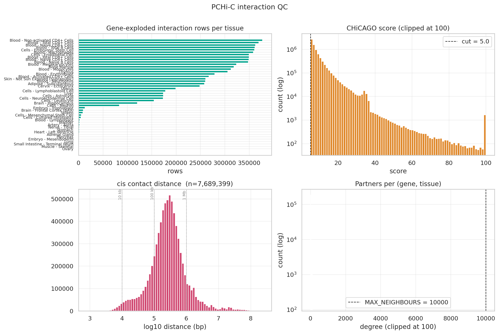 | 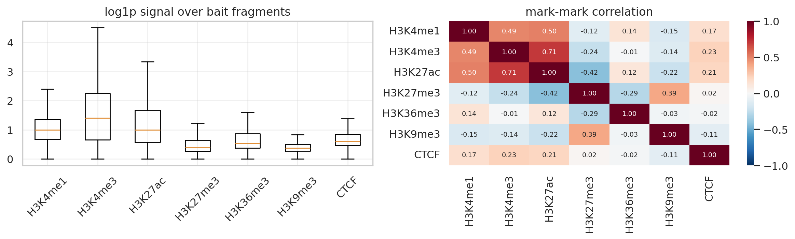 |
| **01** PCHi-C interaction QC | **03** Histone-mark features |
| 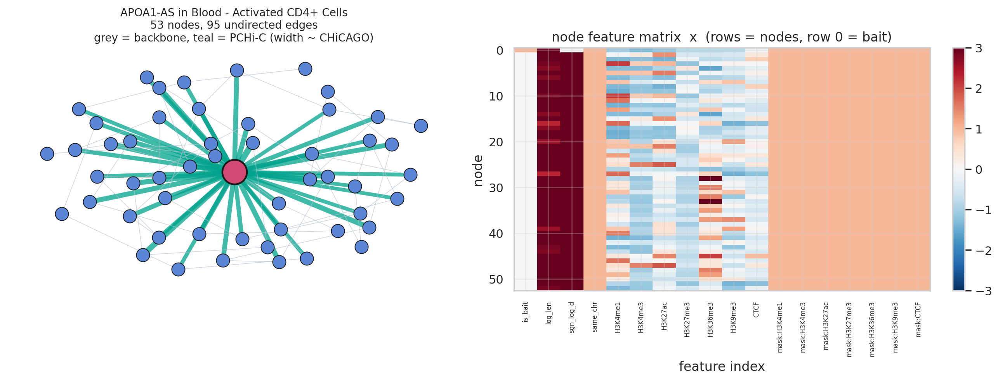 | 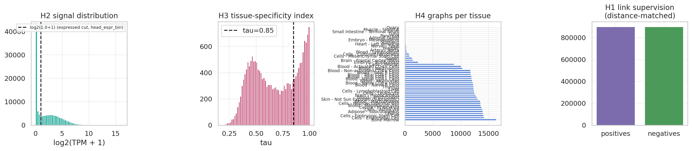 |
| **04** An example promoter subgraph | **05** Label distributions |

### Performance

| | |
|---|---|
| 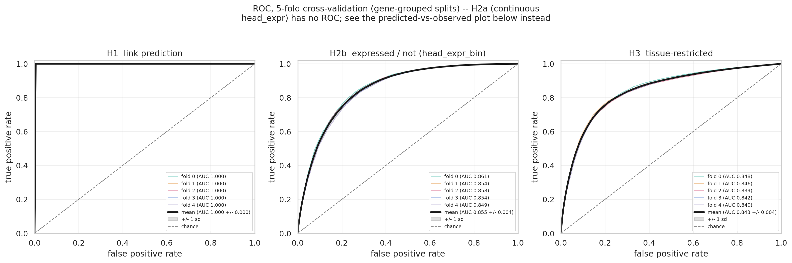 | 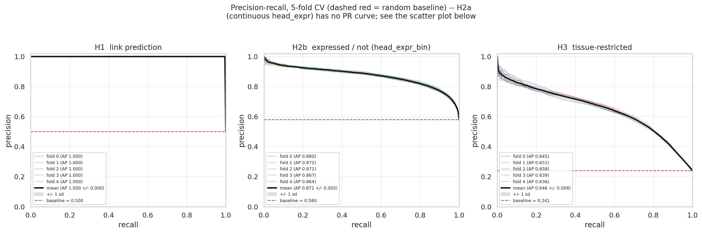 |
| **07** ROC curves | **08** Precision–recall curves |
| 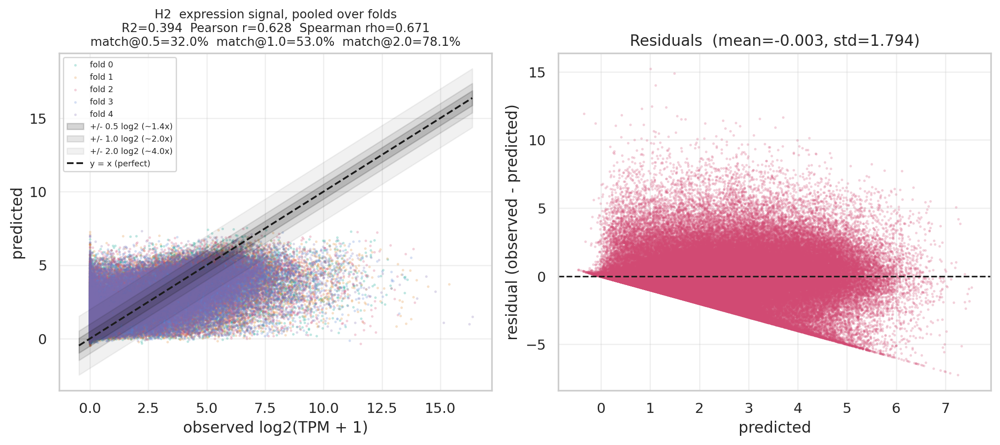 | 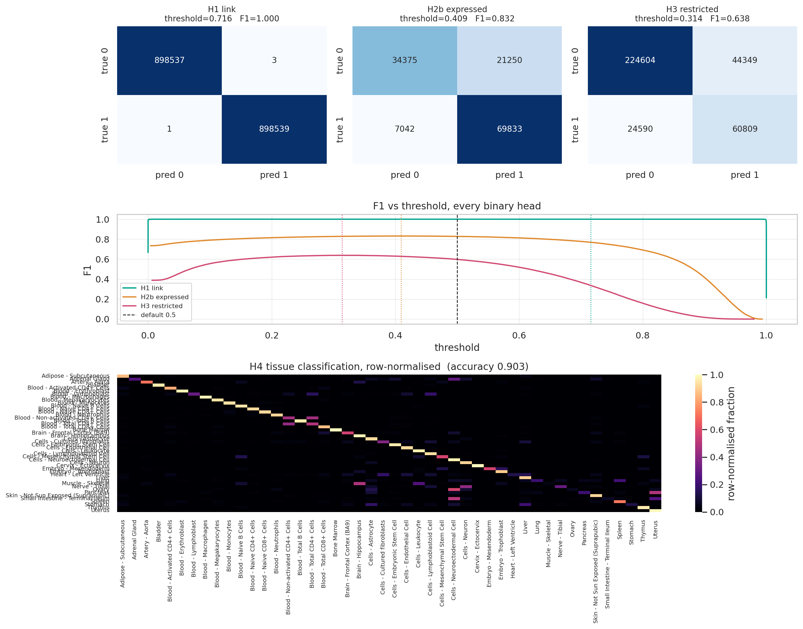 |
| **07b** H2a predicted vs. observed expression | **09** Confusion matrices |
| 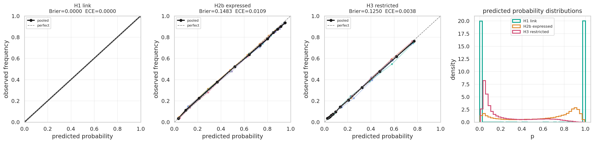 | 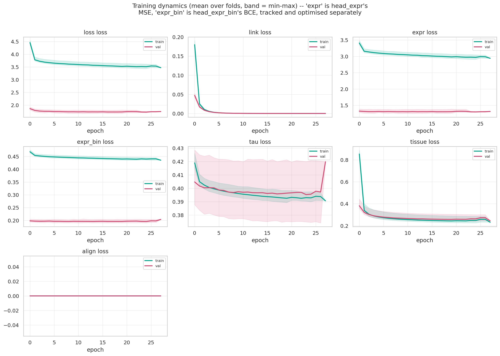 |
| **10** Calibration | **11** Training curves |

### Representation

| | |
|---|---|
| 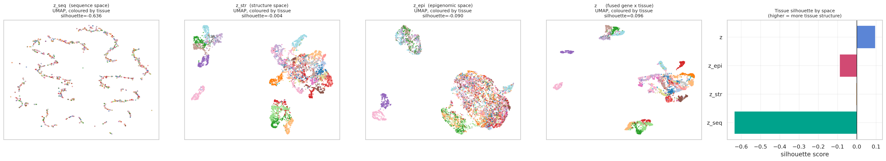 | 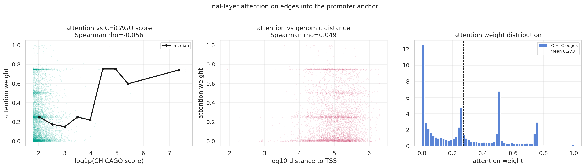 |
| **12** The embedding spaces | **13** What the graph attention attends to |

### Ablation and baselines

| | |
|---|---|
| 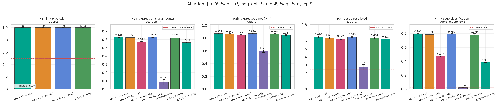 | 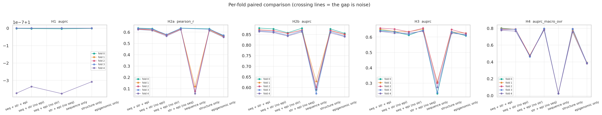 |
| **14** Ablation, per head | **15** Ablation, paired by fold |
| 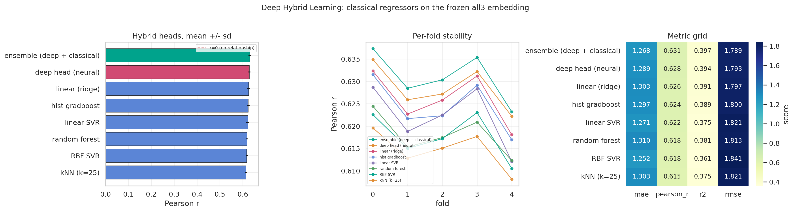 | 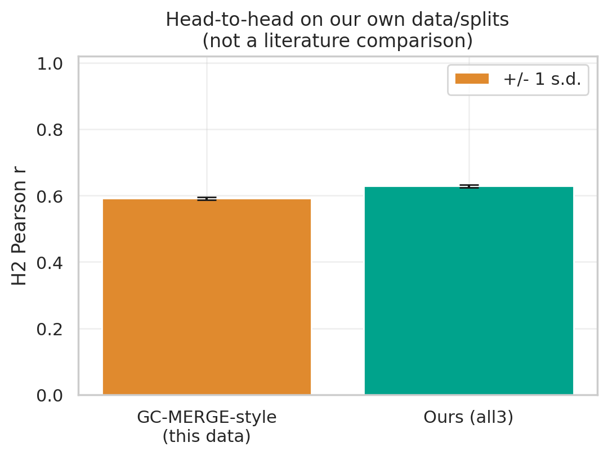 |
| **19** Classical heads on the embedding | **22** Head-to-head with a GC-MERGE-style GCN |

### Validation and robustness

| | |
|---|---|
| 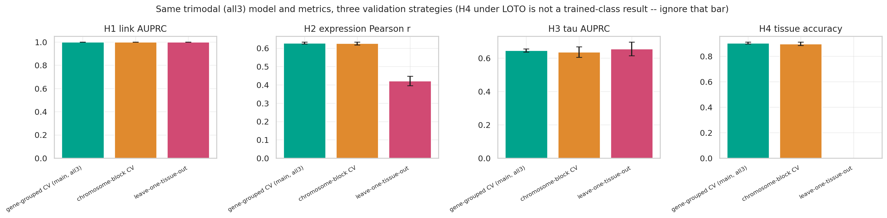 | 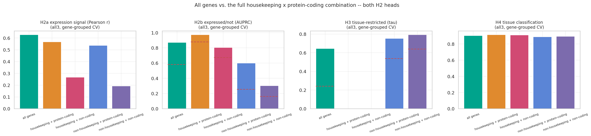 |
| **20** Gene CV vs. chromosome CV vs. leave-one-tissue-out | **21** Stratified evaluation |
| 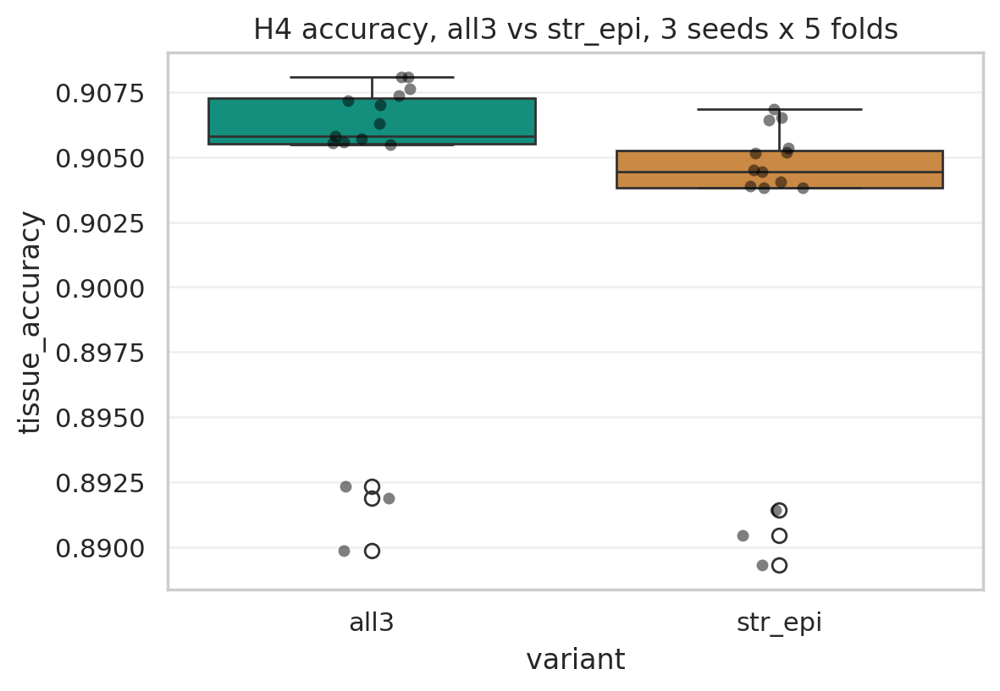 | 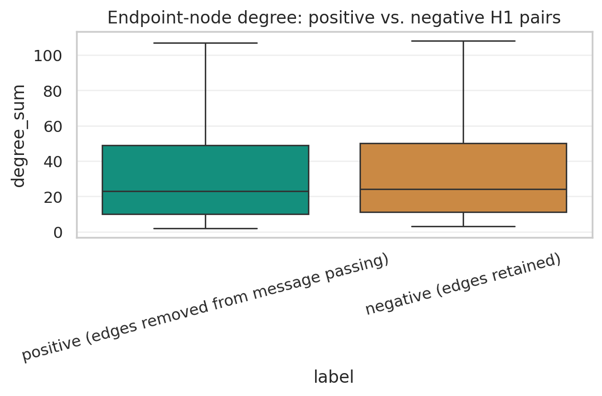 |
| **24** Multi-seed replication (H4) | **25** H1 topological asymmetry |
| 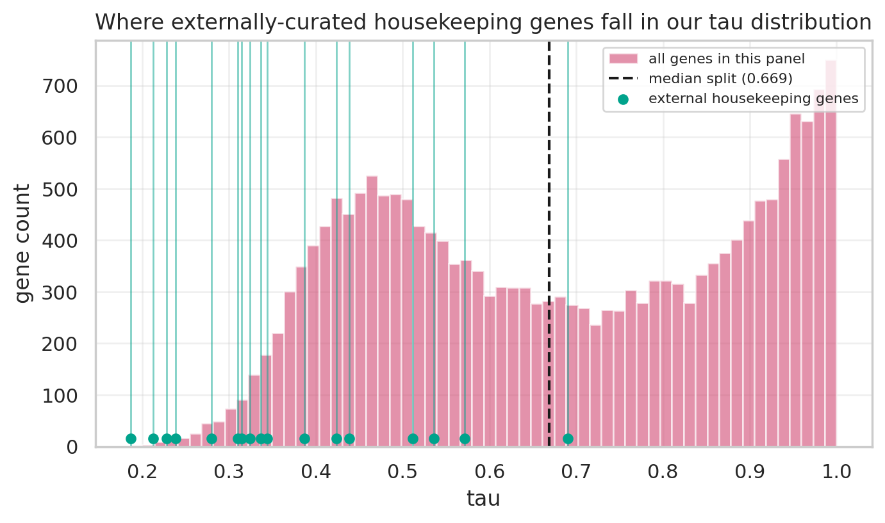 | 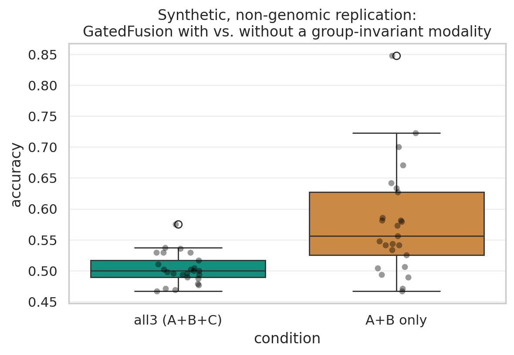 |
| **26** Housekeeping external validation | **27** Does fusion harm generalise? (synthetic) |

More figures (02, 06, 16–18, 23) are in the same folder.

---

## 6. Repository layout

```
.
├── README.md
├── environment.yml                 # conda env "pchic" (CUDA 12.1, PyTorch 2.5.1, PyG 2.8)
├── download_data.sh                # references, liftOver chains, ENCODE histone bigWigs
├── codes/
│   ├── fetch_histone_encode.py     # tissue -> ENCODE biosample -> best bigWig per mark
│   ├── fetch_hic.py                # ENCODE / 4DN .hic fetcher (not needed by this pipeline)
│   └── download_snyder_cohasin.py  # Grubert et al. cohesin HiChIP downloader
├── notebooks/
│   ├── pangenomic_gat_pipeline_trimodal_1mb_SERVER_v3.py   # <- current pipeline
│   ├── pangenomic_gat_pipeline_trimodal_1mb_SERVER_v2.{py,ipynb}
│   ├── pangenomic_gat_pipeline_trimodal_1mb_SERVER{,_latest,_optimized,_resume}.py
│   ├── pangenomic_gat_pipeline_trimodal_1mb_manuscript_completeness.{py,ipynb}
│   ├── pangenomic_gat_pipeline_trimodal_1mb_full_h2signal_complete.{py,ipynb}
│   ├── pangenomic_gat_pipeline_trimodal_1mb{,_stratified,_h2_signal,_FINAL}.ipynb
│   └── py_to_ipynb.py              # "# %%" script -> .ipynb
├── run_trimodal_v3_chain.sbatch    # self-resubmitting SLURM chain for v3 (also v2/server/resume variants)
├── jupyter_h200.sh                 # JupyterLab on a GPU node
├── histone/  hic/  grubert_cohesin/   # download manifests only (data are git-ignored)
├── results/                        # every run's metrics, figures and summaries (section 4)
└── results_trimodal_1mb_stratified_full/
```

### Pipeline lineage

`trimodal_1mb.ipynb` was the first 1 Mb trimodal version. It led to `_stratified`, `_h2_signal`, `_full_h2signal_complete` and `_manuscript_completeness`, which added the stratified evaluation, the continuous H2a head and Parts V–XIII. `SERVER.py` is the headless server port, with checkpointing and resume. `SERVER_v2.py` replaced the external warm start with two-stage, leak-free training. `SERVER_v3.py` keeps v2's model and adds parallel Stage A and the speed-ups.

---

## 7. Method notes and caveats

**Two-stage, leak-free training (v2 onward).** For every split:

- **Stage A** trains the full model end to end on that split's training genes only.
- **Stage B** freezes the encoders and caches their outputs. It then trains each ablation arm's fusion and heads on those cached tensors.

No encoder ever sees a test gene. Caches are keyed on a content hash, writes are atomic, and checkpoints refuse to resume across a config change.

**Assembly.** The PCHi-C fragments are hg19, and the pipeline verifies this against refGene before using them. GRCh38-only bigWigs are kept as they are, and the query intervals are lifted from hg19 to GRCh38 at read time, which is exact for interval lookups.

**Masking, not imputation.** A missing histone mark is set to 0 together with `mask:{mark} = 0`. A failed bigWig read is counted and treated as missing. Genes without RNA-seq get label `-1` and are masked out of the loss.

**Where to be sceptical.**

1. **H1 is near-saturated.** Distance-matched negatives defeat a distance-only model (AUROC 0.50), but the structure tower sees the graph the link was drawn from. Treat H1 as a topology-recognition check, not a headline.
2. **H4 largely follows from structure and histone state**, so high tissue accuracy is a sanity check, not evidence that the embedding is good.
3. **Tau is a per-gene label**, constant across a gene's tissues. Gene-grouped folds prevent leakage, but they do not make H3 harder than it is.
4. **Ablation arms share their split's encoders** (trained as all3). The ablation measures what each representation contributes, not how well each tower would train on its own.
5. **The sequence tower is trained from scratch**, not initialised from a pretrained HyenaDNA checkpoint.

---

## 8. Citation and licence

See `CITATION.cff` (GitHub's *Cite this repository* button) and `.zenodo.json`. Licensed under the terms in `LICENSE`.

Sequence tower adapted from HyenaDNA (Nguyen et al., 2023; [HazyResearch/hyena-dna](https://github.com/HazyResearch/hyena-dna)). Deep Hybrid Learning heads after [SFGLab/DHL](https://github.com/SFGLab/DHL).
